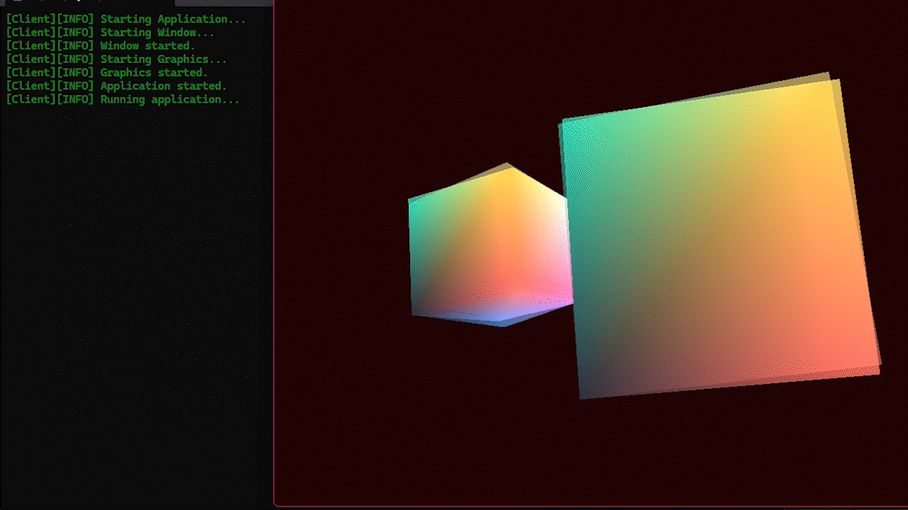

# HotChocolateRenderer

HotChocolateRenderer (HCR) is a C++ rendering project exploring GPU-based software rasterization using NVIDIA CUDA, with Direct3D 12 handling graphics presentation.

## Preview

## Architecture

The solution is organized into the following projects:

| Project | Description |
|---|---|
| `HCR.Application` | Application entry point and execution loop. |
| `HCR.Core` | Shared definitions and core utilities. |
| `HCR.Platform` | Win32 window management and input handling. |
| `HCR.Graphics.D3D12` | Direct3D 12 device initialization, rendering resources, and presentation. |
| `HCR.CUDA` | CUDA kernels and GPU computation. |
| `HCR.Graphics.Interop` | CUDA-D3D12 interoperability. |
| `HCR.Renderer` | Rendering logic. |

## Implementation Status

### Platform
- Win32 window creation.
- Message processing.
- Keyboard and mouse input.

### Direct3D 12
- Device and command queue initialization.
- Swap chain and back-buffer management.
- RTV and DSV descriptor heaps.
- Vertex and index buffer creation.
- Root signature and graphics pipeline state.
- HLSL shaders.
- Indexed drawing.
- Frame presentation and fence synchronization.

### CUDA
Not implemented yet.

### CUDA-D3D12 Interoperability
Not implemented yet.

## Build

**Requirements**
- Windows
- Visual Studio
- Windows SDK
- NVIDIA GPU
- NVIDIA CUDA Toolkit

Open `HotChocolateRenderer.slnx` in Visual Studio and build the solution using the desired configuration and platform.
